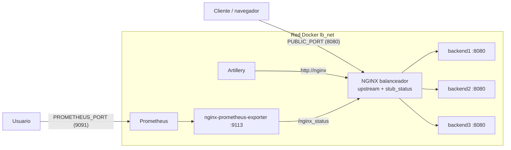

# Balanceador de carga web con NGINX

Proyecto final de **Servicios Telemáticos** (Universidad Autónoma de Occidente, 2026-02).

Clúster de servidores web con **NGINX como proxy inverso y balanceador de carga** hacia tres backends, desplegado completamente con **Docker Compose**. Incluye los algoritmos round-robin, least_conn e ip_hash, métricas en tiempo real con `stub_status` y Prometheus, y pruebas de carga con **Artillery**.

**Integrantes:** _(completar con nombre y código)_

---

## 1. Arquitectura



```
                    Host: puerto PUBLIC_PORT (8080)
                                 │
          ┌──────────────────────▼──────────────────────┐
          │  Red Docker "lb_net"                         │
          │                                              │
          │        ┌──────────────────────────┐          │
          │        │  NGINX (lb-nginx)        │◄─ Artillery
          │        │  upstream backend_pool   │          │
          │        │  /nginx_status           │◄─ nginx-exporter ◄─ Prometheus ──► host :9091
          │        └────┬─────────┬─────────┬─┘          │
          │             ▼         ▼         ▼            │
          │        backend1  backend2  backend3          │
          │          :8080     :8080     :8080           │
          │     (sin puertos publicados en el host)      │
          └──────────────────────────────────────────────┘
```

| Servicio | Imagen | Función | Puerto en el host |
|---|---|---|---|
| `nginx` | `nginx:1.28-alpine` | Balanceador y proxy inverso | `PUBLIC_PORT` (8080) |
| `backend1..3` | `lb-nginx-backend:1.0` (construida desde `backend/`) | Servidor web en Python | Ninguno |
| `artillery` | `artilleryio/artillery` | Pruebas de carga (perfil `test`) | Ninguno |
| `nginx-exporter` | `nginx/nginx-prometheus-exporter` | Convierte `stub_status` en métricas de Prometheus | Ninguno |
| `prometheus` | `prom/prometheus` | Almacena y grafica las métricas | `PROMETHEUS_PORT` (9091) |

Cada backend responde con su nombre (página HTML en `/`, cabecera `X-Backend`), y en `/api/work` simula un tiempo de procesamiento aleatorio entre `WORK_MIN_MS` y `WORK_MAX_MS`, para que la diferencia entre algoritmos sea medible.

---

## 2. Estructura del repositorio

```
.
├── docker-compose.yml           # Definición de todos los servicios
├── docker-compose.override.yml  # Entorno de desarrollo (recarga en caliente)
├── .env                         # Parámetros: política, workers, puertos
├── Makefile                     # Atajos de comandos
├── backend/
│   ├── Dockerfile               # Imagen base: python:3.12-alpine
│   └── app.py                   # Servidor web de cada nodo
├── nginx/
│   ├── nginx.conf               # Configuración del balanceador (montada como volumen)
│   ├── upstreams/               # Un bloque upstream por algoritmo
│   │   ├── round_robin.conf
│   │   ├── least_conn.conf
│   │   └── ip_hash.conf
│   └── hot-reload.sh            # Recarga en caliente (solo desarrollo)
├── artillery/
│   ├── rampa.yml                # Ramp-up progresivo
│   ├── carga-1000.yml           # 1000 usuarios concurrentes durante ~60 s
│   └── resiliencia.yml          # Carga constante para la prueba de fallo
├── prometheus/prometheus.yml
├── scripts/                     # Automatización de pruebas y análisis
├── logs/nginx/                  # access.log y error.log del balanceador
├── results/                     # Resultados de Artillery y análisis
└── vagrant/Vagrantfile          # VM opcional con Docker preinstalado
```

---

## 3. Requisitos

- Una máquina Linux con **Docker Engine** y el plugin **Docker Compose v2**. Se usó una VM Ubuntu 22.04 en Vagrant (`vagrant/Vagrantfile` la crea con Docker ya instalado).
- `make` (opcional): `sudo apt install -y make`
- `python3` y `curl` en la máquina donde se ejecutan los scripts (vienen en Ubuntu).

---

## 4. Despliegue paso a paso

```bash
# 1. Clonar el repositorio
git clone <URL-del-repositorio> proyecto-lb-nginx
cd proyecto-lb-nginx

# 2. (Opcional) revisar parámetros
cat .env

# 3. Construir y levantar el entorno de pruebas
docker compose -f docker-compose.yml up -d --build      # o: make up

# 4. Verificar que todo esté arriba y healthy
docker compose -f docker-compose.yml ps
```

Abrir en el navegador:

| URL | Qué muestra |
|---|---|
| `http://<IP-de-la-VM>:8080/` | La página del backend que atendió. Al recargar cambia de nodo |
| `http://<IP-de-la-VM>:8080/api/work` | JSON con el backend y el tiempo de procesamiento |
| `http://<IP-de-la-VM>:8080/nginx_status` | Métricas en tiempo real de NGINX |
| `http://<IP-de-la-VM>:9091` | Prometheus (consultar por ejemplo `nginx_http_requests_total`) |

Para apagar todo: `docker compose down`.

---

## 5. Parametrización con `.env`

| Variable | Valores | Uso |
|---|---|---|
| `BALANCE_POLICY` | `round_robin`, `least_conn`, `ip_hash` | Elige qué archivo de `nginx/upstreams/` se monta en NGINX |
| `NGINX_WORKERS` | número o `auto` | Se pasa a NGINX con `-g "worker_processes ..."` |
| `PUBLIC_PORT` | puerto | Puerto público del balanceador |
| `PROMETHEUS_PORT` | puerto | Interfaz web de Prometheus |
| `WORK_MIN_MS`, `WORK_MAX_MS` | milisegundos | Rango del tiempo de procesamiento simulado |

Cambiar de algoritmo:

```bash
bash scripts/cambiar_politica.sh least_conn     # o: make politica P=least_conn
```

El script actualiza `.env`, recrea solo el contenedor de NGINX y comprueba la cabecera `X-Balance-Policy` que devuelve el balanceador.

---

## 6. Configuración de NGINX

- **`upstream backend_pool`** con los tres backends. Cada algoritmo vive en su propio archivo:
  - `round_robin.conf`: sin directiva (es el comportamiento por defecto).
  - `least_conn.conf`: `least_conn;`
  - `ip_hash.conf`: `ip_hash;`
- **Detección de fallos:** `max_fails=3 fail_timeout=10s` en cada servidor.
- **Tiempos de espera:** `proxy_connect_timeout 2s`, `proxy_send_timeout 5s`, `proxy_read_timeout 5s`.
- **Reintentos:** `proxy_next_upstream error timeout http_502 http_503 http_504`, con `proxy_next_upstream_tries 3` y `proxy_next_upstream_timeout 10s`.
- **Conexiones persistentes** hacia los backends (`keepalive 64`, HTTP/1.1).
- **`stub_status`** en `/nginx_status`.
- **Log personalizado** (`log_format balanceo`) que registra el backend que respondió, la dirección del upstream, su código y los tiempos de respuesta.
- **Cabeceras de diagnóstico:** `X-Backend`, `X-Upstream` y `X-Balance-Policy`.

---

## 7. Pruebas

Todas las pruebas usan el archivo base (`-f docker-compose.yml`), sin el override de desarrollo. Los resultados quedan en `results/`.

### 7.1 Funcionamiento de cada algoritmo (con stub_status)

```bash
bash scripts/cambiar_politica.sh round_robin
for i in $(seq 9); do curl -s localhost:8080/api/work; echo; done
bash scripts/estado.sh
```

Repetir con `least_conn` e `ip_hash`. Para ver las métricas en vivo durante una prueba: `bash scripts/estado.sh -w`.

### 7.2 Escenario con ramp-up progresivo

```bash
make rampa
```

Fases: calentamiento (30 s a 5 usuarios/s), rampa de subida (60 s de 5 a 100 usuarios/s) y carga sostenida (30 s a 100 usuarios/s).

### 7.3 Comparación de algoritmos con 1000 usuarios concurrentes

```bash
bash scripts/comparar_algoritmos.sh          # o: make comparar
```

Para cada algoritmo ejecuta `carga-1000.yml` (1000 usuarios virtuales creados en una rampa de 10 s, cada uno con 55 peticiones separadas por 1 s, activos a la vez durante ~60 s) y guarda:

- `results/<algoritmo>_carga.json`: resultados completos de Artillery
- `results/<algoritmo>_stub_antes.txt` y `_stub_despues.txt`: capturas de `stub_status`
- `results/<algoritmo>_distribucion.txt`: peticiones por backend según el log de NGINX
- `results/comparacion.md`: tabla con latencia media, p95, p99 y tasa de error

### 7.4 Resiliencia: eliminar un backend en caliente

```bash
bash scripts/prueba_resiliencia.sh           # o: make resiliencia
```

Con carga constante de 90 s: a los 30 s elimina `backend2` (`docker compose rm -sf backend2`), a los 60 s lo vuelve a crear y recarga NGINX. Genera `results/resiliencia_linea_tiempo.txt`, con las peticiones de cada backend cada 10 s, donde se ve el momento en que `backend2` deja de recibir tráfico y cuándo vuelve.

### 7.5 Análisis de logs

```bash
bash scripts/analizar_logs.sh                # o: make distribucion
```

Muestra la distribución real de peticiones por backend, los códigos de estado y cuántas peticiones se reintentaron en otro backend.

---

## 8. Ejemplos de resultados esperados

Los valores exactos dependen del equipo. Estos son de una ejecución de prueba en una máquina de 2 CPU con `least_conn`:

```
| Prueba | Usuarios | Peticiones | Req/s | Media (ms) | p50 (ms) | p95 (ms) | p99 (ms) | Errores | % error |
| carga  | 1000     | 55000      | 714   | 150.1      | 149.9    | 237.5    | 247.2    | 0       | 0.00%   |

== Peticiones por backend ==
  backend3            18349   33.36%
  backend1            18329   33.33%
  backend2            18322   33.31%
```

Comportamiento esperado por algoritmo:

- **round_robin:** reparto casi exacto de un tercio para cada backend, en orden.
- **least_conn:** reparto parecido, pero favorece al backend con menos peticiones en curso. Con tiempos de respuesta variables suele bajar la latencia de la cola (p95/p99).
- **ip_hash:** **todas las peticiones de Artillery van al mismo backend**, porque todas salen de la misma IP (la del contenedor de Artillery). Es el comportamiento correcto de la afinidad de sesión, y muestra que ip_hash no reparte carga cuando hay pocos clientes distintos.
- **Resiliencia:** con un backend eliminado, el servicio sigue respondiendo. Las peticiones que estaban dirigidas al backend caído se reintentan en otro (aparecen como reintentos en el análisis del log), con un aumento de latencia en ese momento y sin errores o con muy pocos.

---

## 9. Entorno de desarrollo con recarga en caliente

```bash
docker compose up -d --build              # aplica automáticamente docker-compose.override.yml
docker compose logs -f nginx
```

El override reemplaza el arranque de NGINX por `nginx/hot-reload.sh`, que revisa cada 2 s si cambió `nginx/nginx.conf` o el archivo de la política activa. Si cambió, valida la configuración con `nginx -t` y recarga NGINX con `nginx -s reload`, sin cortar las conexiones activas. Si la configuración tiene errores, no recarga y lo informa en el log.

---

## 10. Decisiones técnicas y limitaciones

- **Configuración montada, no copiada:** `nginx.conf` y el archivo del algoritmo se montan como volúmenes de solo lectura. La imagen de NGINX es la oficial, sin modificar.
- **Backends sin puertos en el host:** solo usan `expose`. El único punto de entrada es el balanceador.
- **Resolución de nombres:** NGINX resuelve `backend1..3` al arrancar. Si un backend se recrea con otra IP, hay que recargar NGINX (`nginx -s reload`), y el script de resiliencia lo hace. Las versiones recientes de NGINX permiten el parámetro `resolve` en el upstream para hacerlo automáticamente.
- **ip_hash y Artillery:** como Artillery corre en un solo contenedor, todas sus peticiones comparten IP de origen. Para repartir con ip_hash habría que generar carga desde varios clientes.
- **Recursos:** el generador de carga, el balanceador y los backends corren en la misma máquina, así que compiten por la CPU. Los resultados reflejan el comportamiento relativo entre algoritmos, no la capacidad real de un servidor dedicado.

---

## 11. Cumplimiento de requisitos

| Requisito | Implementación |
|---|---|
| NGINX con upstream hacia mínimo 3 backends | `nginx/upstreams/*.conf`, servicios `backend1..3` |
| round-robin, least_conn e ip_hash | Un archivo por algoritmo, se elige con `BALANCE_POLICY` |
| stub_status | `location = /nginx_status` |
| Timeouts y reintentos | `proxy_*_timeout`, `proxy_next_upstream*`, `max_fails`, `fail_timeout` |
| Artillery con ramp-up progresivo | `artillery/rampa.yml` |
| Comparar rendimiento entre algoritmos | `scripts/comparar_algoritmos.sh` |
| Fallo de backends durante la prueba | `scripts/prueba_resiliencia.sh` |
| docker-compose.yml con NGINX, 3 backends y Artillery | `docker-compose.yml` |
| nginx.conf montado como volumen | `./nginx/nginx.conf:/etc/nginx/nginx.conf:ro` |
| Red con nombre explícito, backends sin puertos en el host | Red `lb_net`, backends solo con `expose` |
| .env con workers, puerto público y política | `NGINX_WORKERS`, `PUBLIC_PORT`, `BALANCE_POLICY` |
| Prometheus + nginx-prometheus-exporter | Servicios `prometheus` y `nginx-exporter` |
| docker-compose.override.yml con recarga en caliente | `docker-compose.override.yml` + `nginx/hot-reload.sh` |
| README con diagrama, comandos y resultados esperados | Este archivo |
| Capturas de stub_status por algoritmo | `results/<algoritmo>_stub_*.txt` |
| Eliminar un backend en caliente | `scripts/prueba_resiliencia.sh` |
| 1000 usuarios concurrentes durante 60 s | `artillery/carga-1000.yml` |
| Latencia media y p99 por algoritmo | `results/comparacion.md` |
| Distribución real de peticiones según los logs | `scripts/analizar_logs.sh` |
